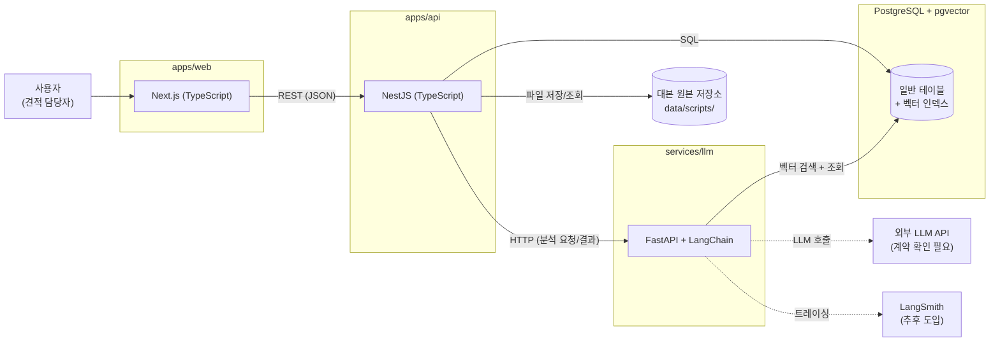
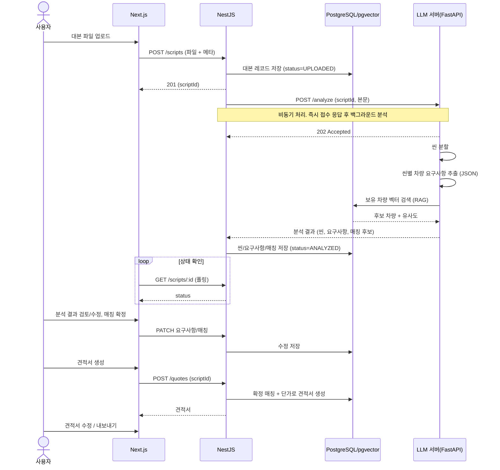

# 아키텍처

> Next.js → NestJS → Python LLM 서버 → PostgreSQL/pgvector
> 상태: 초안

## 1. 전체 구성

## 2. 컴포넌트 책임

| 컴포넌트 | 위치 | 책임 |
|---|---|---|
| Next.js | `apps/web` | 화면, 업로드, 분석 결과/견적서 조회·편집 UI |
| NestJS | `apps/api` | 인증, 대본 저장, 분석 작업 관리, 견적서 생성/저장, 프론트 API 제공 |
| LLM 서버 | `services/llm` | 텍스트 정제, 씬 분할, 차량 요구사항 구조화 추출, 보유 차량 RAG 매칭 |
| PostgreSQL | - | 대본/씬/요구사항/견적서 등 일반 데이터 |
| pgvector | PostgreSQL 확장 | 보유 차량 임베딩 저장, 유사도 검색 |
| 파일 저장소 | `data/scripts/` | 대본 원본 (git 제외) |

## 3. 대본 분석 → 견적서 생성 시퀀스

## 4. 통신 방식 (안)

| 구간 | 방식 | 메모 |
|---|---|---|
| Web → API | REST/JSON | 인증은 Q2 결정 후 |
| API → LLM | HTTP(REST) | 분석은 오래 걸리므로 작업 접수 후 완료 시 결과 전달. 콜백(webhook) 또는 폴링 중 택일 → 아래 결정 필요 |
| LLM → DB | 직접 접근(읽기) | 보유 차량 벡터 검색용. 쓰기는 API만 담당하도록 분리 권장 |
| API → DB | ORM/SQL | 모든 쓰기 |

## 5. 핵심 설계 결정 (제안)

| 주제 | 제안 | 이유 |
|---|---|---|
| DB 쓰기 주체 | NestJS만 쓰기, LLM 서버는 읽기(벡터 검색) 전용 | 데이터 정합성과 책임 분리 |
| 분석 처리 | 비동기 작업 + 상태 필드 | LLM 호출이 느리고 실패 가능 |
| 작업 큐 | MVP는 NestJS 내 단순 비동기, 필요 시 큐(BullMQ 등) 도입 | 초기 복잡도 최소화 |
| LLM 출력 | JSON 스키마 강제 + 검증 | 후속 처리 안정성 |
| 임베딩 | 보유 차량 등록/수정 시 갱신 | 매칭 정확도 유지 |
| 사람 검토 | 분석/매칭 결과는 항상 수정 가능, 자동 확정 없음 | LLM 오류 보정 |
| 평가 | LangSmith는 추후, 모델/프롬프트 버전은 지금부터 기록 | 이후 비교 평가 대비 |

## 6. 보안/기밀 고려

- 대본은 `data/scripts/`에만 보관, git 제외.
- 외부 LLM API 사용 가능 여부는 계약 확인 후 결정 (대안: 로컬/사내 모델).
- LLM 서버는 외부에 직접 노출하지 않고 NestJS를 통해서만 호출.
- LangSmith 도입 시 트레이스에 대본 원문이 남지 않도록 마스킹 정책 필요.

## 질문 목록

| # | 질문 |
|---|---|
| A1 | 외부 LLM API 사용이 불가하면 로컬 모델(성능/GPU 필요)로 가야 하는데 허용 가능한 인프라가 있나요? |
| A2 | LLM 서버가 분석 완료를 알리는 방식: 콜백(webhook) vs NestJS 폴링 중 선호가 있나요? |
| A3 | 대본 원본 저장소는 로컬 디스크로 충분한가요, 객체 저장소(S3 등)를 고려하나요? (배포 환경과 연동) |
| A4 | LLM 서버가 DB를 직접 읽어도 되나요, 아니면 NestJS API를 경유하게 할까요? |
