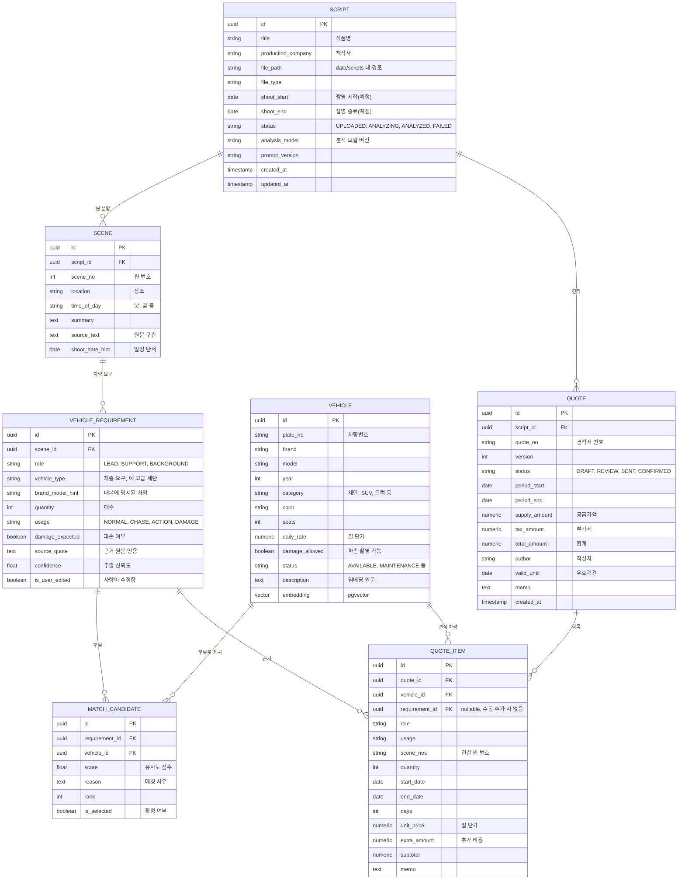

# ERD

> 대본, 씬, 차량요구, 보유차량, 견적서 테이블
> 상태: 초안. 컬럼은 기획 단계 안이며 실제 스키마는 backend가 확정

## 1. ER 다이어그램

## 2. 테이블 설명

| 테이블 | 설명 | 비고 |
|---|---|---|
| SCRIPT | 업로드된 대본 1건. 분석 상태와 모델/프롬프트 버전 기록 | 원문 파일은 `data/scripts/`, DB에는 경로만 |
| SCENE | 대본에서 분할된 씬 | 대본 삭제 시 함께 삭제 |
| VEHICLE_REQUIREMENT | 씬에서 추출한 차량 요구사항 (LLM 구조화 결과) | `is_user_edited`로 사람 수정 구분 |
| VEHICLE | 보유 차량 마스터 + 임베딩 | `embedding`은 pgvector 컬럼, 설명 텍스트로 생성 |
| MATCH_CANDIDATE | 요구사항별 매칭 후보 (RAG 결과) | 요구사항당 후보 여러 건, 선택된 건은 `is_selected` |
| QUOTE | 견적서 헤더 | 대본 1건에 견적서 여러 건/여러 버전 가능 |
| QUOTE_ITEM | 견적서 차량 라인 | 요구사항 없이 수동 추가 가능 (`requirement_id` nullable) |

## 3. 설계 메모

- 단가는 견적 시점 값을 `QUOTE_ITEM.unit_price`에 복사 저장. 이후 차량 단가가 바뀌어도 과거 견적은 유지.
- 견적서 수정 이력은 `QUOTE.version`을 올려 새 행으로 저장하는 방식 제안 (또는 별도 이력 테이블, backend 판단).
- 벡터 인덱스(HNSW/IVFFlat)는 VEHICLE.embedding에 생성.
- 차량 예약/가용 일정은 이번 ERD에서 제외 (Q9 결정 후 `VEHICLE_BOOKING` 추가 가능).
- 작품(Production) 단위로 묶는 구조도 제외 (Q12 결정 후 `PRODUCTION` 추가 가능).
- 사용자/인증 테이블은 제외 (Q1, Q2 결정 후 추가).

## 질문 목록

| # | 질문 |
|---|---|
| E1 | 한 작품에 여러 대본(회차)이 있나요? 있으면 `PRODUCTION` 테이블을 두고 SCRIPT를 그 아래로 묶어야 합니다. |
| E2 | 견적서 버전은 새 행(version 증가)과 별도 이력 테이블 중 어느 쪽이 편한가요? |
| E3 | 차량 가용 일정/예약을 DB에서 관리하나요? (`VEHICLE_BOOKING` 필요 여부) |
| E4 | 추가 비용(보험, 기사, 탁송, 할증)을 자유 입력 금액으로 둘까요, 항목별 테이블로 나눌까요? |
| E5 | 보유 차량의 속성이 더 있나요? (트림, 연료, 외관 상태, 사진, 촬영용 개조 여부 등) |
| E6 | 사용자/역할 테이블이 MVP에 필요한가요? |
