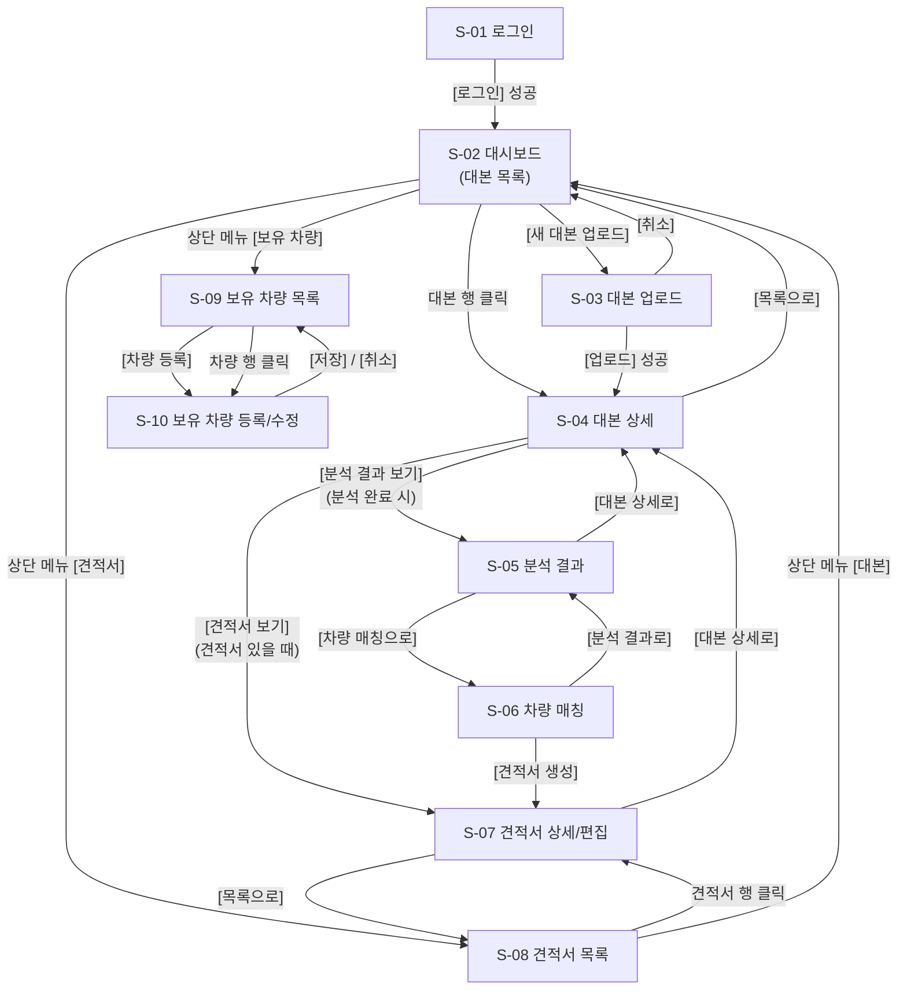
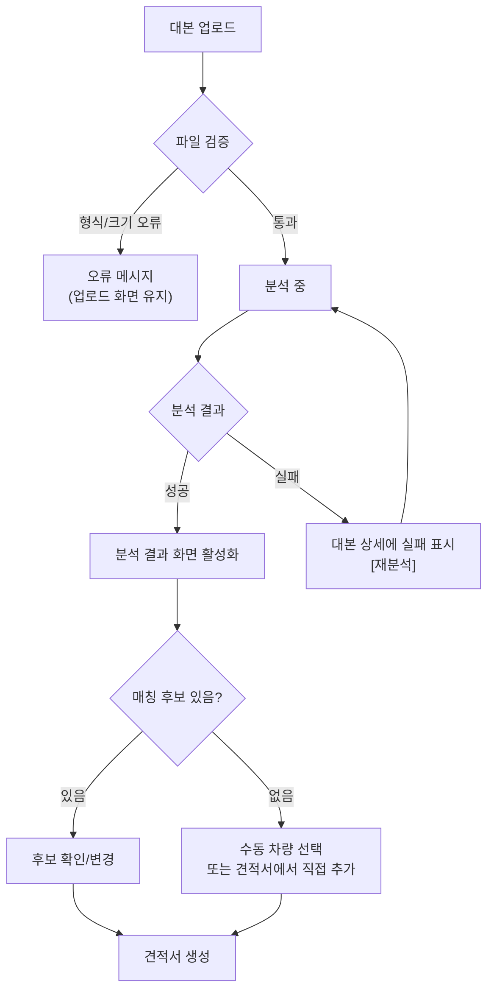

# 화면 흐름도 (User Flow)

> 화면별로 무엇을 누르면 어디로 가는지
> 화면 ID는 `requirements.md`의 화면 목록과 동일
> 상태: 초안

## 1. 전체 화면 이동

## 2. 핵심 업무 흐름 (대본 → 견적서)

## 3. 화면별 상세

### S-01 로그인
| 요소 | 동작 | 이동 |
|---|---|---|
| [로그인] | 인증 성공 | S-02 |
| [로그인] | 실패 | 같은 화면에 오류 메시지 |

### S-02 대시보드 (대본 목록)
| 요소 | 동작 | 이동 |
|---|---|---|
| [새 대본 업로드] | | S-03 |
| 대본 행 클릭 | | S-04 |
| 상태 필터/검색 | 목록 갱신 | 같은 화면 |
| 상단 메뉴 [견적서] | | S-08 |
| 상단 메뉴 [보유 차량] | | S-09 |

### S-03 대본 업로드
| 요소 | 동작 | 이동 |
|---|---|---|
| [업로드] | 파일·메타 검증 후 저장, 분석 요청 | S-04 (상태: 분석 중) |
| [취소] | | S-02 |
| 파일 형식 오류 | 오류 메시지 표시 | 같은 화면 |

### S-04 대본 상세
| 요소 | 동작 | 이동 |
|---|---|---|
| 상태 표시 | 분석 중이면 주기적 갱신(폴링) | 같은 화면 |
| [분석 결과 보기] | 분석 완료 시에만 활성 | S-05 |
| [재분석] | 확인 후 분석 재실행 | 같은 화면 (분석 중) |
| [견적서 보기] | 견적서가 있을 때 | S-07 |
| [삭제] | 확인 후 삭제 | S-02 |
| 분석 실패 상태 | [재분석] 안내 표시 | 같은 화면 |

### S-05 분석 결과
| 요소 | 동작 | 이동 |
|---|---|---|
| 씬 행 펼치기 | 씬별 차량 요구사항과 원문 인용 표시 | 같은 화면 |
| [요구사항 수정] | 인라인 편집 후 저장 | 같은 화면 |
| [요구사항 추가] / [삭제] | | 같은 화면 |
| [차량 매칭으로] | | S-06 |
| [대본 상세로] | | S-04 |

### S-06 차량 매칭
| 요소 | 동작 | 이동 |
|---|---|---|
| 후보 차량 카드 | 점수, 매칭 사유 표시 | 같은 화면 |
| [변경] | 다른 후보 또는 전체 보유 차량에서 선택 | 같은 화면 (모달) |
| [견적서 생성] | 선택된 매칭으로 견적서 생성 | S-07 |
| [분석 결과로] | | S-05 |

### S-07 견적서 상세/편집
| 요소 | 동작 | 이동 |
|---|---|---|
| 항목 셀 편집 (수량, 기간, 단가, 추가 비용) | 소계·합계 자동 재계산 | 같은 화면 |
| [항목 추가] / [삭제] | | 같은 화면 |
| [저장] | 저장 (버전 정책은 E2) | 같은 화면 |
| [내보내기] | PDF/엑셀 다운로드 | 파일 다운로드 |
| [상태 변경] | 초안→검토중→발송→확정 | 같은 화면 |
| [대본 상세로] | | S-04 |
| [목록으로] | | S-08 |

### S-08 견적서 목록
| 요소 | 동작 | 이동 |
|---|---|---|
| 견적서 행 클릭 | | S-07 |
| 상태 필터/검색 | | 같은 화면 |

### S-09 보유 차량 목록
| 요소 | 동작 | 이동 |
|---|---|---|
| [차량 등록] | | S-10 |
| 차량 행 클릭 | | S-10 |
| 검색/필터 | | 같은 화면 |

### S-10 보유 차량 등록/수정
| 요소 | 동작 | 이동 |
|---|---|---|
| [저장] | 저장 + 임베딩 갱신 | S-09 |
| [취소] | | S-09 |
| [삭제] | 확인 후 삭제 | S-09 |

## 4. 예외 흐름

## 질문 목록

| # | 질문 |
|---|---|
| U1 | 분석 중에 다른 화면으로 나가도 되나요? 완료 알림(토스트/이메일)이 필요한가요? |
| U2 | 분석 결과 화면과 매칭 화면을 한 화면(탭)으로 합칠까요, 지금처럼 분리할까요? |
| U3 | 견적서 목록(S-08)을 대시보드와 별도 메뉴로 둘까요? 대본 중심으로만 이동해도 충분한가요? |
| U4 | 매칭 후보가 없을 때 견적서 생성을 막을까요, 빈 항목으로 생성 후 수동 입력을 허용할까요? |
| U5 | 제작사용 조회 화면(읽기 전용 공유 링크 등)이 필요한가요? (Q1과 연동) |
